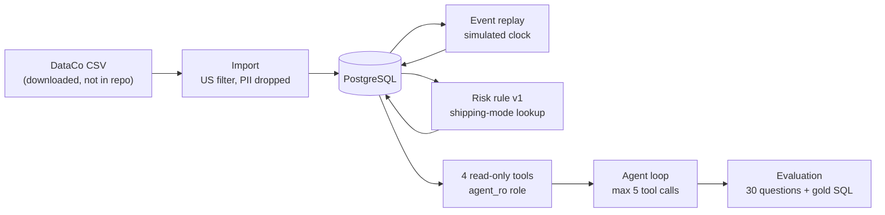

# Logistics Delay Alert Agent

An operations analyst wants to know which orders will arrive late, why, and what to tell the customer. This
project replays five months of historical US orders from the public DataCo supply-chain dataset onto a
simulated clock in PostgreSQL, flags at-risk orders at order time with a simple measurable rule, and lets a
language-model agent answer questions about orders and delays through four read-only tools. The rule
decides what is at risk; the model only explains and drafts. Both parts are evaluated: the rule against two
baselines on a held-out time period, the agent on 30 hand-written questions with answers computed from the
database by independent SQL.

## The problem, and what this project does not do

**Does:** answer questions such as "Where is order 37065?", "Which shipping mode is late most often?" or
"Which New York orders are at risk right now?" as of the simulated date; draft (never send) customer
notifications; refuse to change data or guess about orders that do not exist.

**Does not:** send emails or messages; train a machine-learning model; stream in real time (replay is a
script); offer a web UI (command line only); let the agent write SQL or modify the database (its role is
`SELECT` only). See sections 1–2 of [docs/design.md](docs/design.md).

## Architecture



- **Import** (`scripts/import_data.py`, `etl/`): keeps orders whose destination is the US, drops personal
  columns before storage, groups items into orders and checks order-level consistency.
- **Replay** (`scripts/replay_events.py`): writes `order_placed`, `sla_due` and `order_completed` events day
  by day and raises overdue alerts; "now" is always the simulated date, never today's date.
- **Risk rule v1** (`scripts/evaluate_risk.py`): flags an order when its shipping mode's late rate in the
  April–June training period is above 50%, using only information known at order time.
- **Tools** (`agent_tools/`): `get_order_timeline`, `list_at_risk_orders`, `get_shipping_mode_stats`,
  `draft_notification`; parameterized SQL through the read-only `agent_ro` role.
- **Agent loop** (`agent/`): the model picks a tool, the code validates the arguments and runs it, and the
  model answers. DeepSeek (`deepseek-chat`) and Anthropic adapters are included.
- **Evaluation** (`eval/`, `scripts/run_eval.py`): deterministic checks against gold answers, with a hard
  cost limit.

## Quickstart

Tested on macOS with Python 3.13.7, Docker (PostgreSQL 16) and GNU Make.

```bash
git clone <your-fork-url> logistics-delay-agent
cd logistics-delay-agent
cp .env.example .env          # then change POSTGRES_PASSWORD and AGENT_RO_PASSWORD
make setup                    # creates .venv and installs requirements.txt
```

**Download the dataset** (about 96 MB; not redistributed here, see [DATA_LICENSE.md](DATA_LICENSE.md)):

1. Open the [Kaggle dataset page](https://www.kaggle.com/datasets/shashwatwork/dataco-smart-supply-chain-for-big-data-analysis)
   (free account needed) and click **Download**.
2. Unzip it and move `DataCoSupplyChainDataset.csv` into `data/`:

```bash
mkdir -p data
mv ~/Downloads/archive/DataCoSupplyChainDataset.csv data/   # adjust the path to where you unzipped it
```

License: CC0: Public Domain (as listed on Kaggle, checked 2026-10-10). Citation: Constante, Fabian; Silva,
Fernando; Pereira, António (2019), "DataCo SMART SUPPLY CHAIN FOR BIG DATA ANALYSIS", Mendeley Data, V5,
doi: [10.17632/8gx2fvg2k6.5](https://doi.org/10.17632/8gx2fvg2k6.5).

**Build and check everything (no API key needed):**

```bash
make up              # start PostgreSQL; creates the roles and schema on first start
make import          # load the CSV
make replay          # replay events up to the simulated date 2016-08-31
make evaluate-risk   # risk flags + reports/risk_eval_v1.md
make summary         # reports/data_summary.md
make test            # offline tests with a fake model
make check-secrets   # scan files, logs, reports and git history for secrets
```

**Ask the agent (needs a model key):** set `DEEPSEEK_API_KEY` in `.env`, then

```bash
make ask Q="What is the status of order 37065 as of 2016-06-30?"
make ask                      # interactive mode
make docker-ask Q="..."       # same, inside the app container
make eval                     # live evaluation, capped at MAX_COST=0.25 USD
make logs-summary             # error rate, latency, tokens and cost from logs/agent_calls.jsonl
```

`make help` lists every target.

**Troubleshooting:** if `make up` fails with `01-init-roles.sh: Is a directory`, Docker cannot see the
project folder (Colima, for example, shares only your home directory by default). Clone inside your home
directory, then run `docker compose down -v` and `make up` again.

## Results

### Data

From [reports/data_summary.md](reports/data_summary.md): 24,840 US order items, 8,270 orders from
2016-04-01 to 2016-08-25, 48 destination states. 383 orders (1,120 items) were canceled or suspected fraud
and are excluded from evaluation, leaving 7,887 orders.

### Risk rule v1 (test period July–August 2016, 3,012 orders)

Copied from [reports/risk_eval_v1.md](reports/risk_eval_v1.md) (order level; 95% confidence intervals):

| Predictor | TP | FP | FN | TN | Precision (95% CI) | Recall (95% CI) | Accuracy |
|---|---|---|---|---|---|---|---|
| rule_v1 | 918 | 117 | 798 | 1179 | 88.7% [86.6%, 90.5%] | 53.5% [51.1%, 55.8%] | 69.6% |
| always_late | 1716 | 1296 | 0 | 0 | 57.0% [55.2%, 58.7%] | 100.0% [99.8%, 100.0%] | 57.0% |
| never_late | 0 | 0 | 1716 | 1296 | n/a | 0.0% [0.0%, 0.2%] | 43.0% |

The rule flags First Class (training late rate 100.0%) and Second Class (80.5%). Same Day (46.0%) sits just
below the 50% threshold; the report shows what happens at 0.45 instead of tuning the threshold.

### Agent evaluation

30 questions, one run each, `deepseek-chat`, simulated clock 2016-08-31. Copied from
[reports/agent_eval_2026-10-10.md](reports/agent_eval_2026-10-10.md):

| Metric | Value |
|---|---|
| Answer accuracy | 86.7% |
| Trap pass rate | 100.0% |
| Tool-call success rate | 83.3% (30 calls) |
| Average latency per question (s) | 1.84 |
| 95th-percentile latency (s) | 2.94 |
| Average tokens per question | 3264 |
| Average cost per question | $0.000932 |
| Total cost | $0.027968 |
| Runs that hit the 5-call limit | 1 |
| Questions run / total runs | 30 / 30 |

| Category | Passed | Runs | Accuracy |
|---|---|---|---|
| lookup | 5 | 6 | 83.3% |
| aggregate | 6 | 8 | 75.0% |
| reasoning | 3 | 4 | 75.0% |
| trap | 12 | 12 | 100.0% |

With one run of 30 questions these rates are rough; one question more or less moves accuracy by 3.3 points.
The 4 failures are listed with the gold SQL and the agent's answers in
[reports/agent_eval_failures_2026-10-10.md](reports/agent_eval_failures_2026-10-10.md). In short: a draft
that did not say "not sent" in the expected words (L6); a per-state count that ran into the 5-call limit
(A4); an overdue count taken from a
list capped at 50 rows, 23 instead of 25 (A7); and a refusal to explain First Class delays instead of
citing the 1-day promise against 2 days actual (R1). The system prompt was not tuned to fix them.
Of the 5 tool calls that did not succeed, 4 are A4's calls refused by the 5-call limit and 1 is the expected
"order not found" error in trap T1 (from the transcripts in `reports/transcripts/2026-10-10/`).

A real transcript of five questions with their tool calls is in [docs/demo.md](docs/demo.md).

## Key design decisions

From the decision log in section 12 of [docs/design.md](docs/design.md):

| Decision | Why |
|---|---|
| Filter on destination country, not customer country | Customer country has only two values and would keep every row |
| Exclude `Shipping canceled` items from evaluation | They are labeled "not late" even when they never shipped, which would distort accuracy |
| Do not use `Order Status` as a signal | It contradicts `Delivery Status` and is not fixed at order time |
| Rules decide, the language model explains | Rule output can be measured; model guesses cannot |
| Split by time, not at random | Predicting the future from the past is the honest test |
| Overdue alert is not counted as model accuracy | It equals the label by construction |
| Agent connects with a read-only role and fixed tools | The model never writes SQL and cannot change data |
| Simulated clock instead of today's date | The data is from 2016 |

## Limitations

- **One dataset, five months, 2016.** US orders only span 2016-04-01 to 2016-08-25, so nothing here says
  anything about seasonality or other years.
- **Delays follow scheduling rules.** First Class always takes 2 days against a 1-day promise; the data looks
  generated from rules rather than real carrier behavior, so results are not real-world delivery
  performance.
- **Excluded orders are simplified.** Every `Shipping canceled` order (canceled or suspected fraud) is left out
  of evaluation entirely, although the rule still flags them at order time because exclusion is unknown
  then.
- **The rule is a lookup on shipping mode.** It cannot tell two orders with the same mode apart. Within
  Standard Class, none of the order-time features checked (weekday, month, department, segment, quantity,
  discount, price) moved the late rate by more than about 6 points, and per-state differences were within
  what chance produces at those sample sizes (design doc, section 3).

## Repository structure

| Path | Contents |
|---|---|
| `etl/` | Import transforms, state-name mapping, replay and risk logic |
| `agent_tools/` | The four read-only tools, argument validation, tool registry |
| `agent/` | Agent loop, system prompt, model adapters (DeepSeek, Anthropic), cost and call log |
| `eval/` | Question set, gold SQL and gold answers, checkers, runner, reports |
| `scripts/` | Command-line entry points (see `make help`); `inspect_*.py` are the original data-exploration scripts |
| `db/` | Role setup, schema, one migration for older databases |
| `config/pricing.json` | Per-million-token prices used for cost reporting |
| `reports/` | Generated reports (risk evaluation, data summary, agent evaluation) |
| `tests/` | pytest suite; `tests/fixtures/synthetic_dataco.csv` is invented data for CI |
| `docs/` | Design doc (the spec) and the demo transcript |
| `.github/workflows/ci.yml` | CI: PostgreSQL service, synthetic fixture, offline tests, secret scan |

## Running the tests

`make test` runs everything offline with a fake model; no API key is needed. Tests that need PostgreSQL skip
when the database is not running, and tests whose expected numbers only hold for the real dataset (marked
`real_data`) skip when a different dataset is loaded. CI loads the synthetic fixture instead of the real
data:

```bash
.venv/bin/python scripts/import_data.py --csv tests/fixtures/synthetic_dataco.csv
```

The one live test calls the real model and runs only with `RUN_LIVE=1`.

## Cost of an evaluation run

Prices are read from [config/pricing.json](config/pricing.json) (deepseek-chat: $0.28 per million input tokens,
$0.42 per million output tokens). `make eval` refuses to start without prices and stops once the spend
reaches `MAX_COST` (default $0.25), or earlier if the next question could push it past the limit.

Measured: the 30-question run on 2026-10-10 cost $0.027968, or $0.000932 per question on average
([report](reports/agent_eval_2026-10-10.md)). The five demo questions cost $0.004222 together
([docs/demo.md](docs/demo.md)).

## License

Code: MIT ([LICENSE](LICENSE)). Data: not included; see [DATA_LICENSE.md](DATA_LICENSE.md).
